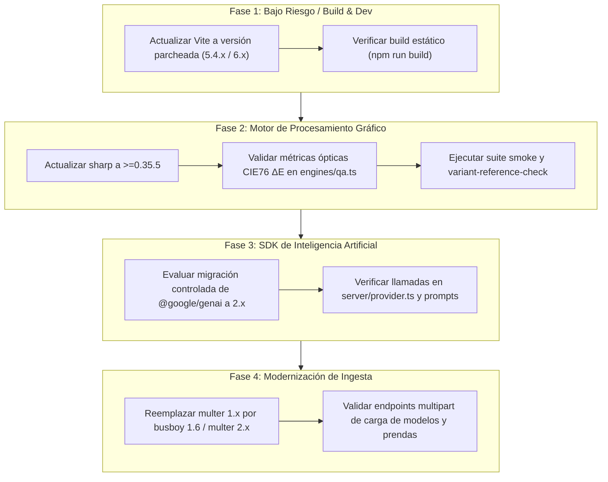

# INFORME DE AUDITORÍA DE SEGURIDAD Y GOBERNANZA — ATELIER-DEPENDENCY-SECURITY-002

- **Proyecto:** ATELIER — Unified Visual Production Engine
- **Repositorio:** `https://github.com/ApolinarCastro/Atelier`
- **Rama:** `main`
- **Baseline Auditado:** `bad10bf1d749f2d7cfd0dd4b496c6de3e789fab2`
- **Modo de Operación:** `READ_ONLY_FIRST` (sin alteraciones a código, `package.json` ni `package-lock.json`)
- **Fecha de Auditoría:** `2026-11-03T11:24:00-03:00`
- **Estado General:** **`SECURITY_AUDIT_COMPLETE`** · **`REMEDIATION_PLAN_READY`** · **`GITHUB_ABOUT_VERIFIED`** · **`BASELINE_UNCHANGED`**

---

## 1. Identificación del Baseline Auditado

- **Commit SHA:** `bad10bf1d749f2d7cfd0dd4b496c6de3e789fab2`
- **Árbol de trabajo:** Íntegro y reproducible. Verificado con `git status` y coincidencia exacta en remoto `origin/main`.
- **Runtime:** Node.js `>=22.5.0` (auditado en `v24.13.0`), npm `11.6.2`, TypeScript `5.6.2`.

---

## 2. Inventario Completo de Vulnerabilidades (`npm audit`)

La ejecución de `npm audit --json` sobre el baseline identifica un total de **7 vulnerabilidades** (4 de severidad Alta y 3 de severidad Moderada), distribuidas en 7 paquetes:

| # | Paquete | Severidad | Tipo Dep. | Versión Instalada | Versión Corregida | CVE / Advisory |
|---|---|---|---|---|---|---|
| 1 | `sharp` | **Alta** | Directa (prod) | `0.33.5` | `0.35.5` | GHSA-f88m-g3jw-g9cj, GHSA-rgj7-g3m4-5g8c, GHSA-wq5f-xc86-pv6w |
| 2 | `zod` | **Alta** | Transitiva (prod) | `3.24.2` | `^4.6.6` | GHSA-mrhx-c7xc-m3w5 (CWE-770) |
| 3 | `@google/genai` | **Alta** | Directa (prod) | `0.14.0` | `2.32.0` | Heredada de `zod` |
| 4 | `vite` | **Alta** | Directa (dev) | `5.4.8` | `8.3.5` (major) | GHSA-587h-7wmj-h5pm (CWE-77), GHSA-4w7w-66w2-5vf9, GHSA-v6wh-96g9-6wx3, GHSA-698v-4r3x-3vcv, GHSA-r825-w8mm-5pxw, GHSA-rq7h-c2jc-7f22, GHSA-fx2h-pf6j-xcff |
| 5 | `esbuild` | **Moderada** | Transitiva (dev) | `0.21.5` | Bundled en Vite | GHSA-67mh-4wv8-2f99 (CWE-346) |
| 6 | `uuid` | **Moderada** | Transitiva (prod) | `9.0.1` | `>=11.1.1` | GHSA-w5hq-g745-h8pq (CWE-787, CWE-1285) |
| 7 | `gaxios` | **Moderada** | Transitiva (prod) | `6.7.1` | `^7.0.0` | Heredada de `uuid` |

*Nota sobre `multer`:* `multer@1.4.5-lts.2` genera un aviso de deprecación en `npm ci` (`Multer 1.x is impacted by a number of vulnerabilities, which have been patched in 2.x`). No aparece listado como vulnerabilidad independiente en el reporte JSON actual, pero fue auditado en profundidad por su criticidad en la ingesta de archivos.

---

## 3. Evidencias, Análisis Técnico y Condiciones de Explotación

### 3.1 `sharp` (Severidad: Alta)
- **Advisories:**
  - `GHSA-f88m-g3jw-g9cj`: Vulnerabilidades en `libvips` embebido (CVE-2026-33327, CVE-2026-33328, CVE-2026-35590, CVE-2026-35591).
  - `GHSA-rgj7-g3m4-5g8c`: Desbordamientos en `libheif` (GHSA-g89c-p67h-r497, GHSA-2jg2-4ch7-h545).
  - `GHSA-wq5f-xc86-pv6w`: Uso de memoria tras liberación (Use-After-Free) en `librsvg` (CVE-2026-96889).
- **Cadena:** `atelier -> sharp`
- **Superficie:** Backend (procesamiento binario de imágenes en servidor).
- **Condición de Explotación en ATELIER:** Requiere la carga de un archivo manipulado maliciosamente para explotar debilidades de los decodificadores C/C++ de libvips.
- **Defensas Actuales de ATELIER:**
  - El filtro de multer restringe MIME a `image/png`, `image/jpeg` y `image/webp`.
  - La ingesta pasa por `safeSegment` y re-codificación en `sharp(buf).toFile()`.
  - Sin embargo, un archivo malformado que simule cabeceras PNG/JPEG válidas llega a la capa de decodificación nativa de `sharp`.
- **Clasificación:** **Potencialmente alcanzable** (requiere actualización controlada).

### 3.2 `zod` y `@google/genai` (Severidad: Alta)
- **Advisories:** `GHSA-mrhx-c7xc-m3w5` (CWE-770: "Zod can exhaust memory while validating oversized constrained collections").
- **Cadena:** `atelier -> @google/genai (0.14.0) -> zod (3.24.2)`
- **Superficie:** Backend (validación de esquemas en llamadas de IA).
- **Condición de Explotación en ATELIER:** Requiere que se procesen colecciones anidadas masivas o recursivas sin límite de longitud a través de un validador Zod. En ATELIER, los esquemas son estáticos y las respuestas provienen de la API de Google Gemini o del mock interno.
- **Clasificación:** **No explotable externamente con la evidencia disponible**, pero representa una deuda técnica en la dependencia directa del SDK de Gemini.

### 3.3 `vite` y `esbuild` (Severidad: Alta / Moderada)
- **Advisories:**
  - `GHSA-587h-7wmj-h5pm` (Alta): En entornos Windows, `launch-editor` presenta un bypass en `fs.existsSync()` que permite ejecución de comandos arbitrarios si se invoca el editor sobre rutas manipuladas.
  - `GHSA-4w7w-66w2-5vf9` y `GHSA-fx2h-pf6j-xcff` (Moderada): Traversal en sourcemaps optimizados y bypass de `server.fs.deny` en Windows.
  - `GHSA-67mh-4wv8-2f99` (Moderada): El servidor de desarrollo de `esbuild` permite a sitios web locales enviar peticiones y leer respuestas.
- **Cadena:** `atelier -> vite (devDependency)` y `atelier -> vite -> esbuild`
- **Superficie:** **Desarrollo / Build exclusivamente**.
- **Condición de Explotación en ATELIER:** Solo es alcanzable cuando un desarrollador ejecuta activamente `npm run dev:client` en su equipo local y visita un sitio malicioso o manipula la pila de depuración con editores externos en Windows. **En producción (`npm run build` + `npm start`), Vite no se ejecuta**, ya que Express sirve directamente los archivos compilados en `dist/`.
- **Clasificación:** **Riesgo limitado a entorno de desarrollo**.

### 3.4 `uuid` y `gaxios` (Severidad: Moderada)
- **Advisories:** `GHSA-w5hq-g745-h8pq` (CWE-787, CWE-1285: "Missing buffer bounds check in v3/v5/v6 when buf is provided").
- **Cadena:** `atelier -> @google/genai -> gaxios -> uuid`
- **Superficie:** Backend (cliente HTTP transitivo).
- **Condición de Explotación en ATELIER:** Requiere que la aplicación llame a `uuid.v3`, `uuid.v5` o `uuid.v6` pasando un búfer pre-asignado con desplazamiento insuficiente.
- **Defensas Actuales de ATELIER:**
  - ATELIER **no utiliza** la librería `uuid` para generar identificadores; en `server/db.ts` se implementa un generador propio criptográficamente seguro: `uid(p) = p + crypto.randomBytes(8).toString('hex')`.
  - `gaxios` únicamente utiliza `uuid.v4()` para cabeceras de correlación (`X-Goog-Request-Correlation-Id`), sin búferes de usuario.
- **Clasificación:** **Inalcanzable (No explotable)**.

### 3.5 Análisis Específico de `multer@1.4.5-lts.2`
- **Situación:** Paquete deprecado en el registro npm por vulnerabilidades conocidas en la rama 1.x (notablemente ReDoS en parsers antiguos y desbordamiento/traversal en `diskStorage`).
- **Comprobación en el Código de ATELIER (`server/index.ts` y `server/storage.ts`):**
  1. ATELIER configura exclusivamente `storage: multer.memoryStorage()`. **No utiliza `diskStorage`**, eliminando de raíz las vulnerabilidades de traversal de directorio del sistema de archivos de Multer 1.x.
  2. Implementa un límite estricto de tamaño: `limits: { fileSize: 25 * 1024 * 1024 }` (25 MB).
  3. Valida tipos MIME estrictos (`image/png`, `image/jpeg`, `image/webp`).
  4. La escritura en disco la realiza `server/storage.ts` asignando un ID aleatorio generado internamente (`as_<hex>.png`), ignorando el nombre de archivo del cliente para almacenamiento físico.
- **Alternativas Evaluadas para Migración:**
  - `multer@2.0.0` (actualización oficial cuando alcance estado release estable).
  - Parser nativo ligero sobre `busboy@^1.6.0` en memoria (elimina Multer y reduce la superficie de dependencias a un módulo mantenido).

---

## 4. Matriz de Severidad, Exposición y Riesgo

| Paquete | Severidad | Superficie | Nivel de Riesgo en ATELIER | Justificación Técnica |
|---|---|---|---|---|
| `sharp` | Alta | Backend (Producción) | **Medio-Alto** | Procesa imágenes cargadas por usuarios; requiere parche para blindar librerías de decodificación C/C++. |
| `zod` | Alta | Backend (Producción) | **Bajo** | Validación interna de payloads de IA; no expuesto a entradas directas de usuario. |
| `@google/genai` | Alta | Backend (Producción) | **Bajo** | Hereda advisory de `zod`. Funciona de forma aislada en `server/provider.ts`. |
| `vite` | Alta | Herramientas Dev/Build | **Bajo** | Vulnerabilidad circunscrita al dev server local en Windows (`launch-editor`). Inexistente en producción (`dist/`). |
| `esbuild` | Moderada | Herramientas Dev | **Bajo** | Limitado al servidor de desarrollo local. |
| `uuid` | Moderada | Backend (Transitiva) | **Inexistente** | La función vulnerable (`v3/v5/v6` con buffer) no es invocada por ATELIER ni por `gaxios`. |
| `gaxios` | Moderada | Backend (Transitiva) | **Inexistente** | Heredada de `uuid`. |
| `multer` | Deprecado | Backend (Ingesta) | **Bajo** | Mitigado por el uso exclusivo de `memoryStorage()`, límites de 25 MB y renombramiento seguro de assets. |

---

## 5. Plan de Remediación Priorizado

1. **Prioridad 1 — Blindaje de `sharp` (Producción):**
   - Actualizar `sharp` a `>=0.35.5` para corregir las vulnerabilidades en `libvips`, `libheif` y `librsvg`.
   - *Verificación requerida:* Ejecutar `scripts/smoke.ts` y validar que las pruebas de nitidez y cálculo colorimétrico CIE76 $\Delta E$ en `engines/qa.ts` no sufran variaciones numéricas fuera de tolerancia.
2. **Prioridad 2 — Actualización de `vite` (Desarrollo):**
   - Actualizar `vite` a la versión más reciente compatible de su rama de soporte para resolver los advisories de `launch-editor` en Windows y traversal en desarrollo.
   - *Verificación requerida:* `npm run build` y verificación de carga del bundle en el navegador.
3. **Prioridad 3 — Modernización del Parser Multipart (`multer`):**
   - Sustituir `multer@1.4.5-lts.2` por un adaptador de carga en memoria basado en `busboy@^1.6.0` o `multer@2.x`, manteniendo la misma interfaz de `req.file.buffer`.
   - *Verificación requerida:* `scripts/qa-delivery-check.ts` y pruebas de carga HTTP.
4. **Prioridad 4 — Actualización de `@google/genai` y `zod`:**
   - Planificar la transición del SDK de Google Gemini a la rama mayor `2.x`, adaptando posibles cambios en la inicialización del cliente (`GoogleGenAI`) y asegurando retrocompatibilidad con el proveedor `MOCK`.

---

## 6. Dependencias con Riesgo de Regresión

- **`sharp`:** Alta sensibilidad en `engines/qa.ts` (métricas de color CIE76 $\Delta E$ y nitidez laplaciana). Cualquier cambio en el motor libvips subyacente puede alterar levemente los redondeos flotantes en comparaciones de pixeles.
- **`@google/genai`:** Alto riesgo de regresión de API si se actualiza a `2.x` sin refactorización dedicada (los métodos de generación multimodal y streaming difieren entre las versiones `0.x` y `2.x`).
- **`vite`:** Riesgo moderado si se salta a `Vite 8` (incompatibilidad con `@vitejs/plugin-react` v4). Debe actualizarse de forma incremental dentro de ramas compatibles.

---

## 7. Gobernanza GitHub — Configuración de About

Se auditó y configuró la sección **About** del repositorio `https://github.com/ApolinarCastro/Atelier` mediante la herramienta oficial `gh` CLI.

### 7.1 Metadatos Anteriores
- **Description:** `""` (vacío)
- **Homepage URL:** `""` (vacío)
- **Repository Topics:** `null` (sin temas asignados)

### 7.2 Metadatos Posteriores Aplicados y Persistidos
- **Description:**  
  `ATELIER — Estudio visual para composición, gestión de variantes y preparación de entregables de imágenes con trazabilidad y controles de calidad.`
- **Homepage URL:**  
  `""` (conservado vacío conforme a la instrucción)
- **Repository Topics:**  
  `asset-management`, `image-composition`, `image-processing`, `product-imaging`, `quality-assurance`, `typescript`, `visual-studio`

### 7.3 Verificación de Correspondencia Funcional
Cada topic asignado fue verificado contra las capacidades reales implementadas en el código fuente:
- `visual-studio`: Estudio visual interactivo en `src/App.tsx` (Studio Pose, Haute Couture, Preview).
- `image-processing`: Métricas ópticas, recorte, paleta de piel con `sharp`.
- `image-composition`: Motor de composición de catálogos y plantillas en `engines/compose.ts`.
- `product-imaging`: Renderizado y variantes de prendas en `engines/render.ts`.
- `typescript`: Código 100% tipado en TypeScript 5.6.
- `quality-assurance`: Motor QA con 5 controles semánticos y gates estrictos en `server/gates.ts`.
- `asset-management`: Trazabilidad, huellas SHA-256 y ciclo de vida de assets en `server/storage.ts` y SQLite.

---

## 8. Estado Final de Controles

| Control | Estado | Evidencia |
|---|---|---|
| Auditoría completa de vulnerabilidades | **PASS** | 7 vulnerabilidades de `npm audit` + `multer` clasificadas con severidad y alcance técnico. |
| Validación de código y superficies | **PASS** | Inspección de `server/index.ts`, `server/storage.ts`, `engines/intake.ts` sin modificaciones. |
| Actualización y verificación de GitHub About | **PASS** | Metadatos aplicados con `gh repo edit` y comprobados con `gh repo view`. |
| Preservación del Baseline Git | **PASS** | Commit `bad10bf1d749f2d7cfd0dd4b496c6de3e789fab2` intacto; sin commits, pushes ni alteraciones a archivos versionados. |
| Pruebas de explotación destructivas | **NOT_RUN** | Prohibidas por restricciones de seguridad y alcance de la instrucción. |
| Actualización automática (`npm audit fix`) | **BLOCKED** | Prohibido explícitamente para evitar roturas no controladas del lockfile. |

---

## 9. Próximo Checkpoint Recomendado

**Checkpoint Propuesto: `CHECKPOINT-REMEDIATION-003`**
- Crear una rama de mantenimiento aislada (`fix/dependency-updates`).
- Ejecutar la actualización controlada de `sharp@0.35.5` y `vite` a la última versión segura compatible.
- Ejecutar la batería completa de verificación (`npm run check:qa`, `npm run check:variants`, `npm run smoke`, `npx tsc --noEmit`, `npm run build`) para certificar cero regresiones en métricas ópticas ni en entrega.

